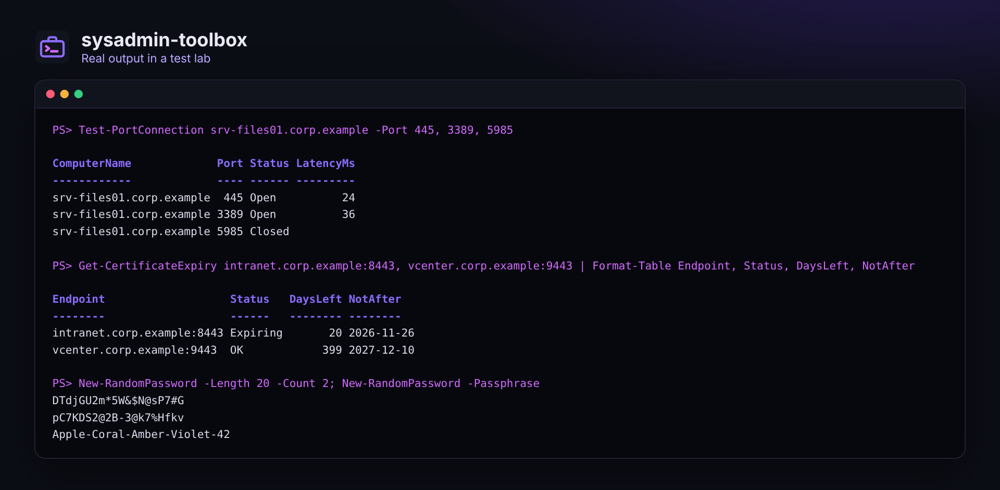
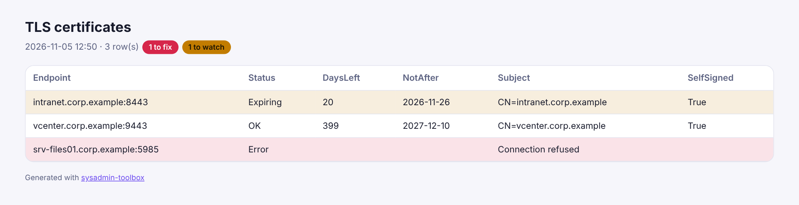

<div align="center">


# sysadmin-toolbox

### Les commandes PowerShell que j'aurais aimé avoir dès mon premier jour d'admin.

**Disques, uptime, redémarrages en attente, postes qui se rallument tout seuls, services arrêtés, admins locaux, erreurs des journaux, ports, certificats,<br>balayage ping et mots de passe : un seul module, des objets simples, et un rapport HTML pour chacun.**

[](https://github.com/B2ZO0/sysadmin-toolbox/actions/workflows/ci.yml)
[](LICENSE)


[English](README.md) · **Français**



</div>

---

## ✨ Commandes

| Commande | À quoi elle répond | Fonctionne sur |
|---|---|---|
| `Get-DiskReport` | Quels disques manquent de place ? | Windows, local ou à distance |
| `Get-UptimeReport` | Quand chaque serveur a-t-il redémarré, et doit-il redémarrer ? | Windows, local ou à distance |
| `Get-PendingReboot` | Un redémarrage est-il en attente, et pourquoi (mises à jour, maintenance, renommage, SCCM) ? | Windows, local ou à distance |
| `Get-WakeReport` | Pourquoi ces postes se rallument-ils tout seuls ? ([l'histoire](docs/rallumage-auto.md)) | Windows, local ou à distance |
| `Disable-AutoWake` | Les empêche de se réveiller, en silence, effectif au prochain arrêt (`-WhatIf` possible) | Windows, local ou à distance |
| `Get-ServiceHealth` | Quels services automatiques ne tournent pas ? | Windows, local ou à distance |
| `Get-LocalAdminReport` | Qui est administrateur local ? (dans toutes les langues de Windows) | Windows, local ou à distance |
| `Get-EventErrorSummary` | Quelles erreurs reviennent le plus dans les journaux ? | Windows, local ou à distance |
| `Test-PortConnection` (`tpc`) | Ce port est-il ouvert, fermé ou filtré ? Plusieurs hôtes et ports en parallèle | Windows, Linux, macOS |
| `Get-CertificateExpiry` | Quand expire le certificat TLS de ce site ou de ce service ? | Windows, Linux, macOS |
| `Invoke-PingSweep` | Quelles adresses répondent dans ce sous-réseau ? | Windows, Linux, macOS |
| `Get-SubnetAddress` | Toutes les adresses d'hôtes d'un sous-réseau CIDR | Windows, Linux, macOS |
| `New-RandomPassword` | Un mot de passe ou une phrase de passe solide, tirés par un générateur cryptographique | Windows, Linux, macOS |
| `ConvertTo-ToolboxHtml` | Transforme la sortie de **n'importe quelle** commande en rapport HTML propre | Windows, Linux, macOS |

Chaque commande renvoie des objets simples : tu peux les trier, les filtrer, les exporter en CSV ou les envoyer à `ConvertTo-ToolboxHtml`. `Get-Help <commande> -Examples` donne des exemples.



## 🚀 Installation

```powershell
# Télécharger et installer pour ton utilisateur (PowerShell 5.1 ou 7)
$zip = "$env:TEMP\sysadmin-toolbox.zip"
Invoke-WebRequest https://github.com/B2ZO0/sysadmin-toolbox/archive/refs/heads/main.zip -OutFile $zip
Expand-Archive $zip -DestinationPath $env:TEMP -Force
$dest = Join-Path ([Environment]::GetFolderPath('MyDocuments')) 'WindowsPowerShell\Modules\SysadminToolbox'   # PowerShell 7 : 'PowerShell\Modules\SysadminToolbox'
Copy-Item "$env:TEMP\sysadmin-toolbox-main\SysadminToolbox" $dest -Recurse -Force
Import-Module SysadminToolbox
```

Ou clone le dépôt et lance `Import-Module .\SysadminToolbox\SysadminToolbox.psd1`.

## 💡 Recettes

```powershell
# Le lundi matin : disques et redémarrages de tous les serveurs, dans un rapport
$servers = (Get-ADComputer -Filter 'OperatingSystem -like "*Server*"').Name
Get-DiskReport -ComputerName $servers | ConvertTo-ToolboxHtml -Title 'Espace disque' -Path disques.html -Open
Get-UptimeReport -ComputerName $servers | Where-Object RebootPending

# « Mon PC s'est rallumé tout seul » : trouver pourquoi, puis corriger en silence
Get-WakeReport -ComputerName PC-012, PC-013
Disable-AutoWake -ComputerName PC-012, PC-013 -WhatIf

# Avant une migration : le nouveau serveur joint-il tout ce qu'il faut ?
Test-PortConnection dc01, dc02 -Port 53, 88, 389, 445, 636, 3268

# Les certificats qui expirent dans les 30 jours
Get-Content sites.txt | Get-CertificateExpiry | Where-Object DaysLeft -lt 30

# Qui est admin local sur le parc
Get-LocalAdminReport -ComputerName $servers | Where-Object Scope -eq 'Local' | Export-Csv admins.csv -NoTypeInformation

# Le premier mot de passe d'un nouvel utilisateur
New-RandomPassword -Length 16 -AsSecureString | Set-ADAccountPassword -Identity jdupont -Reset
```

Les commandes Windows à distance passent par CIM et la communication à distance PowerShell (WinRM), comme les cmdlets intégrées. Pour l'ordinateur local, rien de distant n'est nécessaire.

## 🧪 Testé

Des tests Pester tournent à chaque modification sur **Windows PowerShell 5.1**, **PowerShell 7 sous Windows** et **PowerShell 7 sous Linux** : de vrais ports TCP en écoute pour les tests de ports, chaque règle des mots de passe, le rapport HTML, et chaque commande Windows sur la machine de test elle-même. PSScriptAnalyzer vérifie le code.

## ✈️ De la famille NetCockpit

De petits outils ciblés pour les admins, du débutant au pro, par l'auteur de [**NetCockpit**](https://github.com/B2ZO0/netcockpit), le cockpit en direct de toute ton infrastructure.

| Outil | Ce qu'il fait |
|---|---|
| [NetCockpit](https://github.com/B2ZO0/netcockpit) | Topologie en direct, VMware, switchs, alertes et journaux dans un seul cockpit |
| [ad-audit-report](https://github.com/B2ZO0/ad-audit-report) | Bilan de santé de l'Active Directory sur une page HTML |
| [ansible-debian-baseline](https://github.com/B2ZO0/ansible-debian-baseline) | Un serveur Debian prêt pour la production en un playbook |
| [netconfig-backup](https://github.com/B2ZO0/netconfig-backup) | Les configurations Cisco, FortiGate et UniFi versionnées dans Git |
| [sysadmin-toolbox](https://github.com/B2ZO0/sysadmin-toolbox) | Ce module : les outils PowerShell du quotidien |
| [proxmox-lab-terraform](https://github.com/B2ZO0/proxmox-lab-terraform) | Un lab de test complet sur Proxmox en une commande |

## 🤝 Contribuer

Une commande que tu utilises chaque semaine et que tu aimerais voir ici ? [Ouvre un ticket](https://github.com/B2ZO0/sysadmin-toolbox/issues). Les pull requests sont les bienvenues : un fichier par commande dans `SysadminToolbox/Public`, avec l'aide et un test Pester.

Si ce module t'a fait gagner du temps, une ⭐ aide d'autres admins à le trouver.

---

<sub>Fait par [Enzo Marechal](https://enzomarechal.fr) ([@B2ZO0](https://github.com/B2ZO0)), administrateur système et réseau junior. Licence MIT.</sub>
