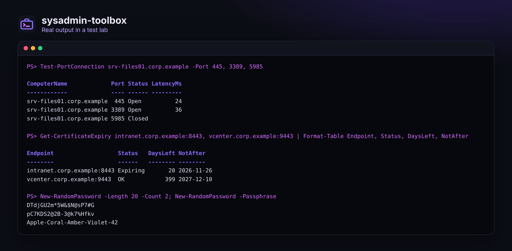
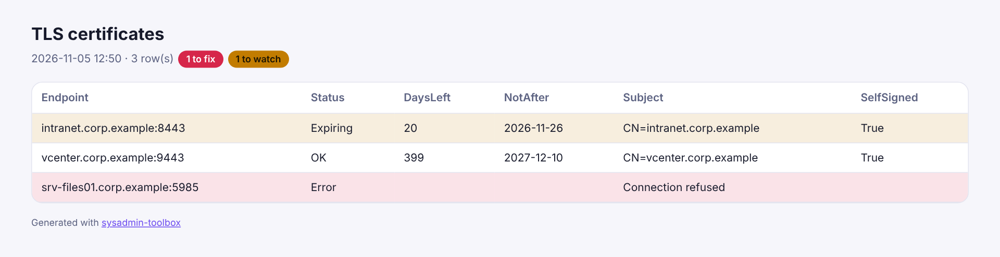

<div align="center">


# sysadmin-toolbox

### The PowerShell commands I wish I had on my first day as a sysadmin.

**Disks, uptime, pending reboots, computers that wake up on their own, stopped services, local admins, event errors, ports, certificates,<br>ping sweeps and passwords: one module, plain objects, and an HTML report for any of them.**

[](https://github.com/B2ZO0/sysadmin-toolbox/actions/workflows/ci.yml)
[](LICENSE)

[](https://github.com/B2ZO0/sysadmin-toolbox/stargazers)

**English** · [Français](README.fr.md)



</div>

---

## ✨ Commands

| Command | What it answers | Runs on |
|---|---|---|
| `Get-DiskReport` | Which disks are running out of space? | Windows, local or remote |
| `Get-UptimeReport` | When did each server last reboot, and does it need one? | Windows, local or remote |
| `Get-PendingReboot` | Is a reboot pending, and why (updates, servicing, rename, SCCM)? | Windows, local or remote |
| `Get-WakeReport` | Why do these computers turn back on by themselves? ([the story](docs/auto-wake.md)) | Windows, local or remote |
| `Disable-AutoWake` | Stops them from waking up, silently, effective at the next shutdown (`-WhatIf` supported) | Windows, local or remote |
| `Get-ServiceHealth` | Which automatic services are not running? | Windows, local or remote |
| `Get-LocalAdminReport` | Who is local administrator? (works in any Windows language) | Windows, local or remote |
| `Get-EventErrorSummary` | Which errors came back most often in the event logs? | Windows, local or remote |
| `Test-PortConnection` (`tpc`) | Is this port open, closed or filtered? Many hosts and ports in parallel | Windows, Linux, macOS |
| `Get-CertificateExpiry` | When does the TLS certificate of this site or service expire? | Windows, Linux, macOS |
| `Invoke-PingSweep` | Which addresses answer in this subnet? | Windows, Linux, macOS |
| `Get-SubnetAddress` | Every host address of a CIDR subnet | Windows, Linux, macOS |
| `New-RandomPassword` | A strong password or passphrase, from a cryptographic generator | Windows, Linux, macOS |
| `ConvertTo-ToolboxHtml` | Turns the output of **any** command into a clean HTML report | Windows, Linux, macOS |

Every command returns plain objects: sort them, filter them, export them to CSV, or pipe them to `ConvertTo-ToolboxHtml`. Run `Get-Help <command> -Examples` for examples.



## 🚀 Install

```powershell
# Download and install for your user (PowerShell 5.1 or 7)
$zip = "$env:TEMP\sysadmin-toolbox.zip"
Invoke-WebRequest https://github.com/B2ZO0/sysadmin-toolbox/archive/refs/heads/main.zip -OutFile $zip
Expand-Archive $zip -DestinationPath $env:TEMP -Force
$dest = Join-Path ([Environment]::GetFolderPath('MyDocuments')) 'WindowsPowerShell\Modules\SysadminToolbox'   # PowerShell 7: 'PowerShell\Modules\SysadminToolbox'
Copy-Item "$env:TEMP\sysadmin-toolbox-main\SysadminToolbox" $dest -Recurse -Force
Import-Module SysadminToolbox
```

Or clone the repository and run `Import-Module .\SysadminToolbox\SysadminToolbox.psd1`.

## 💡 Recipes

```powershell
# Monday morning: disks and reboots of every server, in one report
$servers = (Get-ADComputer -Filter 'OperatingSystem -like "*Server*"').Name
Get-DiskReport -ComputerName $servers | ConvertTo-ToolboxHtml -Title 'Disk space' -Path disks.html -Open
Get-UptimeReport -ComputerName $servers | Where-Object RebootPending

# "My computer turned itself back on": find out why, then fix it silently
Get-WakeReport -ComputerName PC-012, PC-013
Disable-AutoWake -ComputerName PC-012, PC-013 -WhatIf

# Before a migration: can the new server reach what it needs?
Test-PortConnection dc01, dc02 -Port 53, 88, 389, 445, 636, 3268

# Certificates that expire in the next 30 days
Get-Content sites.txt | Get-CertificateExpiry | Where-Object DaysLeft -lt 30

# Who is local admin across the fleet
Get-LocalAdminReport -ComputerName $servers | Where-Object Scope -eq 'Local' | Export-Csv admins.csv -NoTypeInformation

# A new user's first password
New-RandomPassword -Length 16 -AsSecureString | Set-ADAccountPassword -Identity jdoe -Reset
```

Remote Windows commands use CIM and PowerShell remoting (WinRM), like the built-in cmdlets. For the local computer, nothing remote is needed.

## 🧪 Tested

Pester tests run at every push on **Windows PowerShell 5.1**, **PowerShell 7 on Windows** and **PowerShell 7 on Linux**: real TCP listeners for the port checks, every password rule, the HTML report, and every Windows command against the test machine itself. PSScriptAnalyzer checks the code.

## ✈️ Part of the NetCockpit family

Small, focused tools for sysadmins, from beginners to pros, by the author of [**NetCockpit**](https://github.com/B2ZO0/netcockpit), a live cockpit for your whole infrastructure.

| Tool | What it does |
|---|---|
| [NetCockpit](https://github.com/B2ZO0/netcockpit) | Live topology, VMware, switches, alerts and logs in one cockpit |
| [ad-audit-report](https://github.com/B2ZO0/ad-audit-report) | Active Directory health check in one HTML page |
| [ansible-debian-baseline](https://github.com/B2ZO0/ansible-debian-baseline) | A production-ready Debian server in one playbook |
| [netconfig-backup](https://github.com/B2ZO0/netconfig-backup) | Cisco, FortiGate and UniFi configs, versioned in Git |
| [sysadmin-toolbox](https://github.com/B2ZO0/sysadmin-toolbox) | This module: everyday PowerShell tools |
| [proxmox-lab-terraform](https://github.com/B2ZO0/proxmox-lab-terraform) | A complete test lab on Proxmox in one command |

## 🤝 Contributing

A command you use every week and would like to see here? [Open an issue](https://github.com/B2ZO0/sysadmin-toolbox/issues). Pull requests are welcome: one file per command in `SysadminToolbox/Public`, with help and a Pester test.

If this module saved you some time, a ⭐ helps other admins find it.

---

<sub>Made by [Enzo Marechal](https://enzomarechal.fr) ([@B2ZO0](https://github.com/B2ZO0)), junior system and network administrator. MIT license.</sub>
